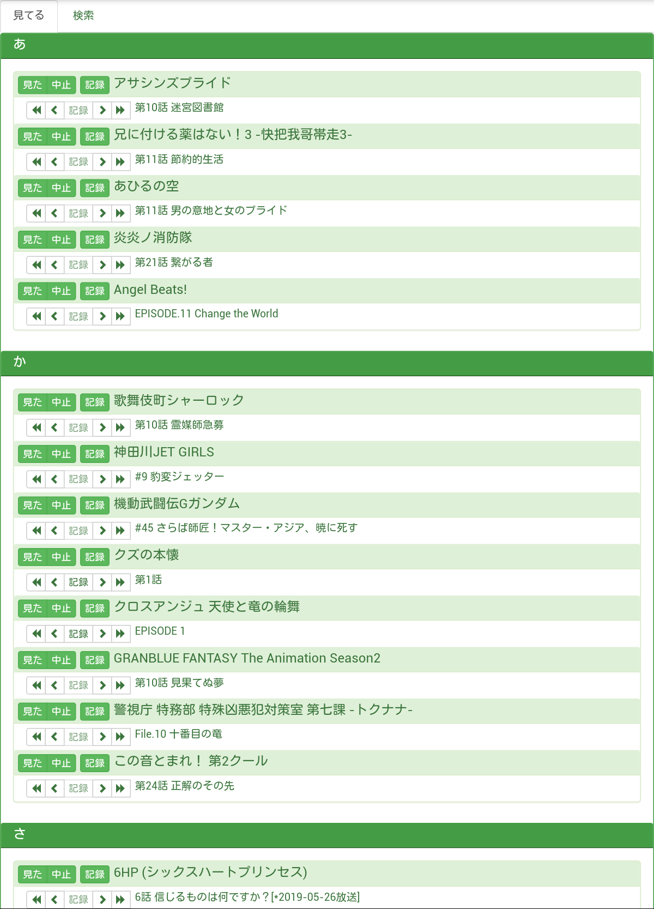

# EcoEco Annict
作品情報をブラウザのストレージにキャッシュすることで通信コストとサーバーの負担を抑えつつ、粛々とアニメの視聴記録を行うための <a href="https://annict.com" target="_blank" rel="noopener noreferrer">Annict</a> 非公式 Web クライアントです。

* Annict の GraphQL API を利用するため Annict の <a href="https://annict.com/sign_up" target="_blank" rel="noopener noreferrer">アカウント登録</a> が必要となります。
* アカウント登録後に <a href="https://wikino.app/s/annict/pages/355" target="_blank" rel="noopener noreferrer">Annict APIの個人用アクセストークン</a> を作成する必要があります。
  * 「読み込み」スコープを持つアクセストークンを使用して以下の情報を取得します。
    * 見てる作品の一覧
    * 作品の視聴ステータス
    * エピソードの記録状態
  * 「書き込み」スコープを持つアクセストークンを使用して以下の操作を行います。
    * 作品の視聴ステータスを変更
    * 作品にレビューを投稿
    * エピソードに記録
  * 作成したアクセストークンは第三者に知られないようにしてください。

---
EcoEco Annict  
https://fluffy-momonga.github.io/ecoeco-annict/index.min.html

